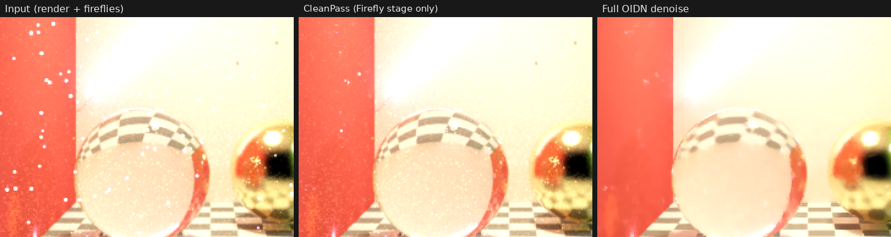

<p align="center">
  <picture>
    <source media="(prefers-color-scheme: dark)" srcset="docs/wordmark_dark.png">
    
  </picture>
</p>

# CleanPass

**One Nuke node to clean CG renders, in three stages: Firefly, Deflicker and Denoise.**

Created by **Gabin Vidal** — v1.0 — <https://www.linkedin.com/in/gabinvidal>

> 🇫🇷 **La version française se trouve [plus bas](#cleanpass-fr).**

| Tab | What it does |
|---|---|
| **Firefly** | Finds the outlier pixels and corrects **only them**, so the grain and the detail of the render are kept. Where fireflies are so dense that they are the light itself (low sample counts), their energy is given back smoothly, so the image keeps its brightness. |
| **Deflicker** | Stabilises the render over time: boiling GI, shimmering speculars, sub-pixel detail crawling as things move. Each pixel is matched in the neighbouring frames and averaged with the samples of the same surface. Where nothing matches (occlusion, a real change) nothing is mixed, so there is no ghosting. Uses the renderer's motion vectors and depth when they are there. |
| **Denoise** | Intel Open Image Denoise 2.5, guided by the albedo and normal passes, stabilised over time, on the beauty and on the light groups. |

Each stage has its own **enable** switch, all off on a new node. They run in this order: Firefly, then Deflicker, then Denoise. The **Setup** tab, first, holds what they share: passes, AOVs, output, mask, mix and the OIDN device.


<sub>Firefly stage only. Left: a 256 spp path-traced render with fireflies. Middle: CleanPass with default settings. Right: a full OIDN denoise, for comparison.</sub>

## Features

- **Firefly detection.** Each pixel goes through a multi-scale isolation test, so blobs made by wide pixel filters are still caught. The pixel is then compared with an expected value: an **OIDN** prediction guided by albedo and normal, or a fast statistical estimate. The threshold adapts to the local noise. Clusters of fireflies are peeled off one by one. The **temporal check** (on by default) compares with frames t-1 and t+1, which protects small real highlights such as rivets or glints.
- **Firefly correction.** A firefly can be replaced by its expected value, the local median, or a clamp. Its coloured filter halo is cleaned too. **Keep energy** (on by default): an isolated firefly is an accident and is removed for good, but where they are dense and carry a real part of the local light (indirect light, caustics or volumes rendered with few samples) they are the noise of the light itself. Deleting them would darken the image, so their energy is given back as a smooth field, spread on the albedo. Away from such areas, the pixels that are not fireflies come out bit-for-bit identical.
- **Deflicker.** Motion is estimated by block matching (coarse, median-filtered, then sub-pixel), guided by the noise-free albedo and normal. Flat areas, where the image alone cannot show the motion, take the motion of the measurable areas around them, and the search widens by itself when things move faster than it. A neighbour sample is averaged only if its patch matches within the measured noise, if it comes from the same surface (guides, depth) if it is not brighter than the cleaned frame around it (the neighbours' fireflies stay out), and if its 5×5 neighbourhood shows the same light, channel by channel, within the noise: a light switching on or off, or a moving shadow, is never blended in. 1 or 2 frames on each side.
- **Motion vectors and depth (optional).** The renderer's motion vectors give the exact motion, even fast or on flat surfaces. Their convention (pixels or NDC, forward or backward, y up or down, full or half frame) is found by checking them against the image (and snapped to the exact scale, so that it is the same on every frame), and every pixel keeps the image's own match where the vectors do not fit (reflections, refraction, transparency). Depth rejects disoccluded samples. Layers with the usual names (`albedo`, `N`, `motionvector`, `depth`/`Z`) are picked up automatically from `src`, and each pass can also come from its own input.
- **Fixed or animated render seed.** Both work. A fixed seed (noise that stays on screen) is detected and the motion search then leans on the guides instead of the noise pattern.
- **Denoise.** OIDN 2.5 in HDR mode (Fast, Balanced or High), on CPU or CUDA, after the firefly and deflicker stages. **Stabilise over time** (on by default): frames t-1 and t+1 go through the same chain and their denoised results are blended in where they agree, which removes the boiling a per-frame denoiser leaves. When playing or rendering in order, the work done on t+1 for the stabilisation of t (firefly, deflicker, denoise) is kept, and frame t+1 starts from it: after the first frame the stabilisation costs one extra frame of processing, not two.
- **AOVs / light groups.** The Setup tab lists the layers of `src` (data passes left out): check the light AOVs to clean. Every stage applies to them, including the denoise. When they add up to the beauty (checked on the image), they still add up exactly to the cleaned beauty.
- **Utilities.** NaN / inf repair, a firefly matte channel, diagnostic views (Fireflies overlay, Removed, Firefly matte, Deflicker weight), a mask input that limits every stage, and mix.
- **Caching.** The analysis is cached per frame. Changing `mix`, `view` or the matte output doesn't trigger a recompute.

## Requirements

- Windows 10/11 x64
- Nuke 16 or Nuke 17. NDK plugins are tied to a Nuke major version, so one build is shipped per version.
- Optional: an NVIDIA GPU for OIDN on CUDA. It falls back to CPU when CUDA isn't available.

## Install

1. Close Nuke.
2. Unzip the release and run `install.bat`, or `python install.py`. This copies the plugin to `~/.nuke/plugins/CleanPass` and registers it in `~/.nuke/init.py`. Running it again is safe.
3. In Nuke the node is under **Filter > CleanPass**, or Tab-search `CleanPass`.

To remove it, run `python uninstall.py`.

## Build from source

You need **Build Tools for Visual Studio 2022** with the *Desktop development with C++* workload. Close Nuke, then run:

```bat
build.bat
```

The script finds every Nuke 16/17 in `C:\Program Files`, downloads the OIDN 2.5.1 SDK into `deps\` the first time, builds `bin\<major>\CleanPass.dll` (plus its `.pdb`) and prepares the OIDN runtime in `oidn\bin\`. To build for a single Nuke, run `build.bat -Nuke "C:\Program Files\Nuke17.0v3"`.

> **About the OIDN runtime.** Nuke 16 and 17 ship an older C++ runtime (msvcp140 14.36) and their own TBB, and recent OIDN builds crash against them; another plugin may also load its own OIDN. So the bundled runtime gets private names (`OIDN_CleanPass25*.dll`, `tbbCP.dll`) and its own C++ runtime (`MSVCP_CP.dll`, a renamed copy of your Visual Studio's msvcp140.dll, 14.40 or newer). It can't clash with anything, and moving to OIDN 3 will only take a version change in `build.ps1`.

## Usage

Inputs: **src** (the render), **albedo**, **normal** and **mask**, plus **motion** and **depth**, which appear when `motion vectors` / `depth` are checked in the Setup tab (the mask always stays last).

- With a multi-layer EXR, plug it into `src` and that's it: albedo, normals, motion vectors and depth are read from its layers (found by name, or set in the Setup tab).
- A pass plugged into its own input is used instead of the layer of `src`: its layer with the usual name if it has one, else its rgb. Neighbour frames are read from that input too, so every stage works with separate inputs.
- Motion vectors and depth serve the Deflicker and `stabilise over time` only.

### Rendering for it (Arnold, Karma)

- Keep the **animated seed** (Arnold's default: `AA_seed` follows the frame). Deflicker and the stabilisation average independent samples; a fixed seed also works, just a little less well.
- Output **albedo** and **N**, and if you can **motionvector** and **Z** (Arnold computes motion vectors only with motion blur on: tick *Instantaneous Shutter* to keep the beauty sharp; in Karma, *Disable Image Blur*).
- For comp in light groups, output them (`RGBA_*`) and check them in the AOV list of the Setup tab.

### Firefly tab

| Knob | Effect |
|---|---|
| **expected value** | `OIDN` is the most accurate. `Statistical` is very fast. |
| **threshold** | How many stops above its expected value a pixel must be to count as a firefly. Lower is more aggressive. |
| **isolation** | How many stops the pixel must stand above the bright part of its neighbourhood. Protects lines, edges and texture. |
| **softness / noise adaptive / min brightness** | Soft transition of the detection, a threshold that rises on noisy areas, and pixels that are never touched. |
| **max size / halo** | Largest firefly radius tested, and the radius of filter halo cleaned around each firefly. |
| **temporal check** | On by default. `motion tolerance` must cover how far things move between two frames. |
| **replace with** | Expected value, Local median, or Clamp (keeps the pixel and only lowers its brightness). |
| **keep energy / radius** | On by default. Gives back, as a smooth field of about `radius` pixels, the energy of fireflies that are dense enough to be the light itself. Off: every firefly is deleted (cleaner shadows, but darker than the render on under-sampled lighting). |

### Deflicker tab

| Knob | Effect |
|---|---|
| **frames** | Averages 1 or 2 frames on each side. 2 is stronger and twice as slow. |
| **amount** | Mix of the stabilised result. |
| **tolerance** | How different a matched sample may be and still be averaged, relative to the measured noise. Higher is stronger; lower is safer on fast changes. |
| **motion search / patch size** | Largest motion between two frames in pixels (it widens by itself when needed), and the size of the patches compared. |
| **use albedo / normal** | Uses the noise-free guides to find the motion. Recommended. |

### Denoise tab

| Knob | Effect |
|---|---|
| **amount** | Mix of the denoised result. Below 1 keeps some grain. |
| **quality / prefilter guides** | OIDN quality (Fast for previews), and whether OIDN should first clean noisy guides. |
| **stabilise over time / tolerance** | Blends the denoised t-1 and t+1 in where they agree. When rendering in order, about 1.6x the time of the same chain without it (2.5x on the first frame). |
| **denoise the AOVs / keep their sum = beauty** | Denoises the AOVs set in the Setup tab and, when they form a complete set, keeps them adding up to the beauty. |

OIDN expects uncorrelated pixel noise. Renders made with a wide pixel filter denoise less well than renders with a box or 1 px filter.

### Setup tab

This tab comes first. It holds the beauty, albedo and normal layers, the `motion vectors` and `depth` options with their layers (empty = found by name, or press `detect layers`; a connected input wins over the layer), the list of AOVs to clean, the `view` (Result, Fireflies overlay, Removed, Firefly matte, Deflicker weight), the matte output, the mask, `mix`, and the OIDN device and memory limit. The Nuke console prints what each frame used (vectors and their convention, fixed seed, depth, stabilisation).

**Tips**

- Turn on only the stages a shot needs. Firefly alone keeps the render untouched apart from the fireflies.
- The more noisy the render, the more the node brings over a plain OIDN denoise. On a render that is already well sampled, Denoise alone is nearly as steady and a little more accurate.
- With Denoise on, the Firefly stage only pays off on strong fireflies that OIDN can't absorb (bright isolated pixels that turn into blotches).
- **With Denoise and `stabilise over time` on, leave Deflicker off.** On the real renders tested, the stabilisation removes almost all of the same flicker on its own without costing any detail, while averaging before OIDN costs a little accuracy and can leave soft streaks in fog or glass. It is also faster (3.9 s instead of 4.3 s per frame on the 1080p shot below). Deflicker is for renders you don't denoise, and can still help on hair or fine detail that crawls.
- Without Denoise, start Deflicker at 1 frame and move to 2 frames if it isn't enough. The `Deflicker weight` view shows where averaging happened.
- Use CUDA for the denoise when you have an NVIDIA GPU: it is the slowest part on CPU.

## How it works and validation

The algorithms (`src/cp_core`, `src/cp_deflicker`, `src/cp_pipeline`) have no Nuke dependency and are validated in `tests/core/` on path-traced renders with a converged reference:

- **Firefly.** With 500 fireflies injected into a converged render and its light AOVs, 99 % of the firefly energy is removed and the error on the affected pixels drops by more than 100×. About 0.15 % of the other pixels are touched, and the AOVs still sum to the beauty.
- **Deflicker** (moving camera and a moving object, error against the reference). 1 frame: -31 % without motion vectors, -34 % with them. 2 frames with vectors and depth: -42 %. Fixed render seed: detected, -39 %. Motion faster than the search: vectors (or the automatic wider search) keep it working.
- **Denoise stability** (difference between consecutive frames once aligned, lower is steadier). OIDN alone: 0.0124 (0.0103 with a fixed seed). Firefly + Deflicker + OIDN: 0.0089. With the stabilisation: 0.0074, i.e. 40 % steadier than OIDN alone, with a lower error too.
- **Light groups.** Two light groups denoised with the beauty: error -59 % and -60 %, and they add up to the denoised beauty to float precision.
- **On a heavily under-sampled Arnold shot** (1920×1080, AA 2 / diffuse 1, a light moving through a dark room; error against the average of 34 other renders of the same frame). All three stages with default settings: per-pixel error equal to OIDN alone (0.0342 vs 0.0343 tone-mapped), 1.6× steadier from frame to frame, and 98 % of the light kept (95 % in the shadows, where OIDN alone keeps 87 %). Without `keep energy` the firefly stage deleted the sparse indirect samples, and the shadows lost 47 % of their light. On a Ryzen 9 7950X3D, OIDN alone takes 1.1 s per frame (0.3 s on CUDA) and Firefly alone 1.5 s.
- **On an Arnold shot with a moving camera, moving objects, glass, chrome and a blinking light** (1920×1080, two light groups, motion vectors; rendered at AA 2 and AA 4, against a reference at AA 8). All three stages are 2.3× steadier than OIDN alone on flat areas at AA 2, and 1.25× at AA 4, with a per-frame error within 3 to 5 % of OIDN alone. The light of the render is kept (output / input 0.998 to 1.002), the light groups still add up to the beauty (1e-7), the motion vectors calibrate themselves (Arnold's default shutter gives half-frame vectors: found ×2), and a light that switches off for one frame stays off. On a Ryzen 9 7950X3D (CPU), all three stages with the stabilisation and two light groups take about 4.3 s per frame when rendering in order (7 s for the first frame), 3.9 s with Deflicker off (nearly the same flicker, a little more accurate).
- **Hard content** (Mitsuba sequences with a moving camera, a moving object and a reference: fog, a curtain of sub-pixel hair, strong depth of field, fast motion blur; `tests/core/render_seq3.py`). Firefly + Denoise + stabilisation is more accurate and steadier than OIDN alone on all four (error 0 to -5 %, frame-to-frame difference -4 to -5 %), with no ghosting on the motion-blurred object or the defocused background. Firefly takes 1 to 2 % of the light in fog, motion blur and defocus (sparse samples that are legitimately bright). Deflicker on top helps hair (-4 % error) but leaves streaks in fog: see the tip above.
- **4K** (3840×2160, all three stages with the stabilisation): about 3.6 GB for the node on top of the input frames, plus what OIDN takes (set its memory limit in the Setup tab if RAM is tight: 1 GB works).
- Everything also runs under AddressSanitizer / UBSan, including NaN / inf, tiny images, odd motion vectors and depths, and every combination of options. The Nuke smoke test (`tests/nuke_smoke_test.py`, 34 checks) passes in Nuke 16 and 17.

## Known limitations

- **Deflicker and the stabilisation need the neighbouring frames to be renderable.** Inputs with a frame range shorter than the shot fall back gracefully at the ends.
- **A tiny real highlight with no help from the guides can be taken for a firefly.** Keep the temporal check on, raise `isolation`, or mask the area.
- **A firefly touching a much brighter feature is left alone**, for example right next to a light source, because it isn't isolated.
- **On very under-sampled lighting, the deflicker leans slightly dark** (-4 % in the mid-tones on the shot above): its outlier tests favour the darker samples. Not visible in practice, but measurable.
- **Reflections and refractions of moving objects can come out slightly smudged on very noisy renders**: the samples are aligned on the surface, not on what it reflects. Lower the deflicker `tolerance`, or mask those areas.
- **The temporal stages want RAM at 4K**: count about 4 GB for the node plus OIDN (see above).
- **All inputs must share the same format.**
- **Windows only for now.** The C++ is portable, but only Windows builds are provided.

## Credits

Created by **Gabin Vidal** — <https://www.linkedin.com/in/gabinvidal>. The one-build-per-Nuke-version layout follows the approach of [NukeCGDenoiser](https://github.com/mateuszwojt/NukeCGDenoiser) by Mateusz Wojt. Uses [Intel Open Image Denoise](https://github.com/RenderKit/oidn) 2.5.1 (Apache 2.0); see `THIRD_PARTY_NOTICES.md`.

## License

MIT — see `LICENSE`. The bundled Open Image Denoise runtime is Apache 2.0 — see `THIRD_PARTY_NOTICES.md`.

---

# CleanPass (FR)

**Un seul node Nuke pour nettoyer les rendus CG, en trois étapes : Firefly, Deflicker et Denoise.**

Créé par **Gabin Vidal** — v1.0 — <https://www.linkedin.com/in/gabinvidal>

| Onglet | Ce qu'il fait |
|---|---|
| **Firefly** | Trouve les pixels aberrants (fireflies) et corrige **uniquement eux** : le grain et le détail du rendu sont conservés. Là où les fireflies sont si denses qu'elles forment la lumière elle-même (peu de samples), leur énergie est rendue en douceur pour que l'image garde sa luminosité. |
| **Deflicker** | Stabilise le rendu dans le temps : GI qui bout, spéculaires qui scintillent, détails sub-pixel qui grouillent. Chaque pixel est retrouvé dans les frames voisines et moyenné avec les samples de la même surface. Là où rien ne correspond (occlusion, vrai changement), rien n'est mélangé : pas de ghosting. Utilise les motion vectors et la depth du rendu s'ils sont là. |
| **Denoise** | Intel Open Image Denoise 2.5, guidé par l'albedo et les normales, stabilisé dans le temps, sur la beauty et sur les light groups. |

Chaque étape a son interrupteur **enable**, toutes éteintes sur un nouveau node. Elles s'enchaînent dans cet ordre : Firefly, Deflicker, puis Denoise. L'onglet **Setup**, en premier, regroupe ce qu'elles partagent : passes, AOVs, sortie, mask, mix et device OIDN.

## Fonctions

- **Détection des fireflies** multi-échelle, comparée à une valeur attendue (prédiction OIDN guidée par albedo et normales, ou estimation statistique rapide), avec un seuil qui s'adapte au bruit local. Le **contrôle temporel** (actif par défaut) compare avec t-1 et t+1 pour protéger les petits vrais highlights (rivets, glints).
- **Correction** par la valeur attendue, la médiane locale ou un clamp, halo du filtre compris. **Keep energy** (actif par défaut) : une firefly isolée est supprimée, mais là où elles sont denses et portent une vraie part de la lumière (indirect, caustiques, volumes peu samplés), leur énergie est rendue sous forme de champ lisse. Ailleurs, les pixels qui ne sont pas des fireflies ressortent identiques au bit près.
- **Deflicker** par block matching guidé par l'albedo et les normales, avec élargissement automatique de la recherche quand ça bouge vite. Un sample voisin n'est moyenné que s'il correspond dans la limite du bruit mesuré, vient de la même surface et montre la même lumière : une lumière qui s'allume ou s'éteint, une ombre qui bouge, ne sont jamais mélangées.
- **Motion vectors et depth (optionnels).** La convention des vecteurs (pixels ou NDC, avant ou arrière, y vers le haut ou le bas, frame entière ou demi-frame) est trouvée toute seule en les vérifiant sur l'image. Les layers aux noms habituels sont détectés automatiquement dans `src`, et chaque passe peut aussi arriver par son propre input.
- **Seed fixe ou animé** : les deux marchent, le seed fixe est détecté.
- **Denoise** OIDN 2.5 en HDR (Fast, Balanced, High), sur CPU ou CUDA. **Stabiliser dans le temps** (actif par défaut) : t-1 et t+1 passent par la même chaîne et leurs résultats débruités sont mélangés là où ils concordent, ce qui enlève le « boiling » d'un denoiser image par image. En rendu dans l'ordre, chaque frame réutilise le travail préparé par la précédente.
- **AOVs / light groups** : l'onglet Setup liste les layers de `src` (sans les passes de data) : on coche les AOVs de lumière à nettoyer. Toutes les étapes s'y appliquent, denoise compris, et ils continuent de s'additionner exactement à la beauty nettoyée.
- **Utilitaires** : réparation des NaN / inf, canal matte des fireflies, vues de diagnostic, input mask qui limite toutes les étapes, mix.

## Pré-requis

- Windows 10/11 x64
- Nuke 16 ou Nuke 17 (un build par version majeure est fourni).
- Optionnel : un GPU NVIDIA pour OIDN en CUDA (retombe sur le CPU sinon).

## Installation

1. Fermer Nuke.
2. Dézipper la release et lancer `install.bat` (ou `python install.py`). Le plugin est copié dans `~/.nuke/plugins/CleanPass` et déclaré dans `~/.nuke/init.py`. On peut le relancer sans risque.
3. Dans Nuke : **Filter > CleanPass**, ou Tab puis `CleanPass`.

Pour désinstaller : `python uninstall.py`. Pour compiler depuis les sources, voir [Build from source](#build-from-source).

## Utilisation

Inputs : **src** (le rendu), **albedo**, **normal** et **mask**, plus **motion** et **depth** qui apparaissent quand `motion vectors` / `depth` sont cochés dans l'onglet Setup (le mask reste toujours le dernier).

- Avec un EXR multicouche, on le branche dans `src` et c'est tout : albedo, normales, motion vectors et depth sont lus dans ses layers (trouvés par leur nom, ou choisis dans Setup).
- Une passe branchée dans son propre input est utilisée à la place du layer de `src` (son layer au nom habituel s'il en a un, sinon son rgb), frames voisines comprises.
- Les motion vectors et la depth ne servent qu'au Deflicker et à « stabiliser dans le temps ».

**Pour le rendu (Arnold, Karma)** : garder le **seed animé**, sortir **albedo** et **N**, et si possible **motionvector** et **Z** (motion blur activé avec *Instantaneous Shutter* dans Arnold, *Disable Image Blur* dans Karma, pour garder la beauty nette). Pour les light groups, les sortir (`RGBA_*`) et les cocher dans la liste des AOVs de l'onglet Setup.

**Conseils**

- N'activer que les étapes dont le plan a besoin. Firefly seul laisse le rendu intact en dehors des fireflies.
- Plus le rendu est bruité, plus le node apporte par rapport à un simple denoise OIDN.
- **Avec Denoise et « stabiliser dans le temps » actifs, laisser le Deflicker éteint** : la stabilisation enlève presque tout le même flicker sans coûter de détail, et c'est plus rapide. Le Deflicker sert aux rendus qu'on ne débruite pas (et peut aider sur des cheveux ou du détail fin qui grouille).
- Sans Denoise, commencer le Deflicker à 1 frame et passer à 2 si besoin.
- Utiliser CUDA pour le denoise si vous avez un GPU NVIDIA.

## Limites connues

- Le Deflicker et la stabilisation ont besoin que les frames voisines existent (repli propre en bord de plage).
- Un tout petit vrai highlight sans aide des guides peut être pris pour une firefly : garder le contrôle temporel, monter `isolation`, ou masquer.
- En 4K, les étapes temporelles demandent de la RAM : environ 4 Go pour le node, plus OIDN (limite mémoire réglable dans Setup).
- Tous les inputs doivent avoir le même format.
- Windows uniquement pour l'instant.

Les mesures de validation détaillées sont dans la [version anglaise](#how-it-works-and-validation).

## Licence

MIT — voir `LICENSE`. Le runtime Open Image Denoise fourni est sous Apache 2.0 — voir `THIRD_PARTY_NOTICES.md`.
